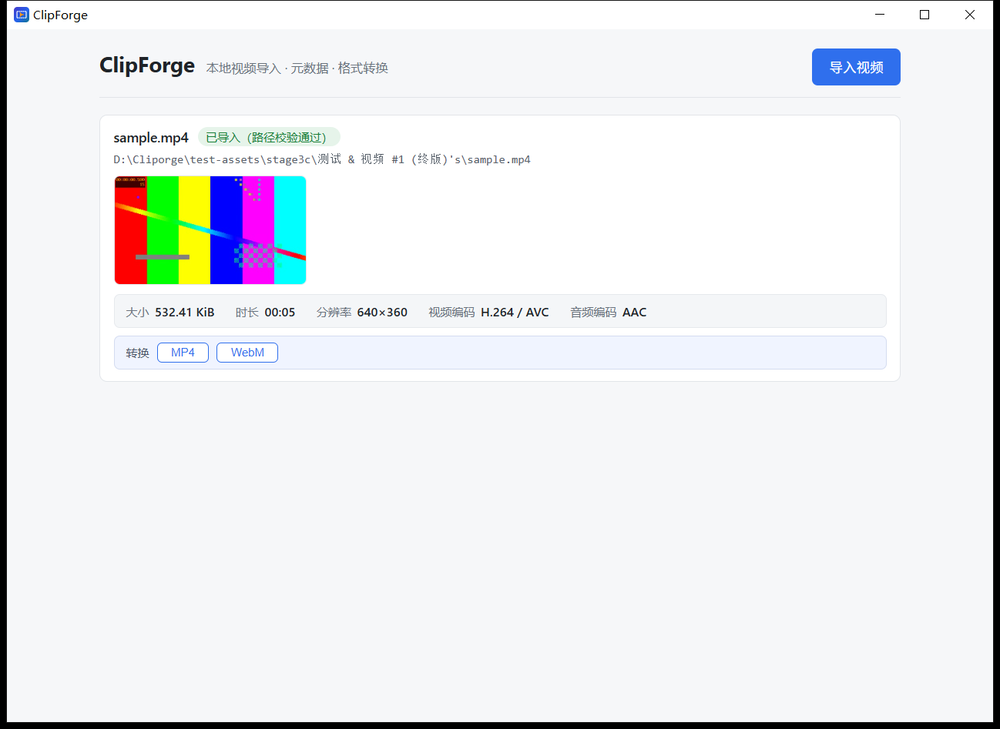
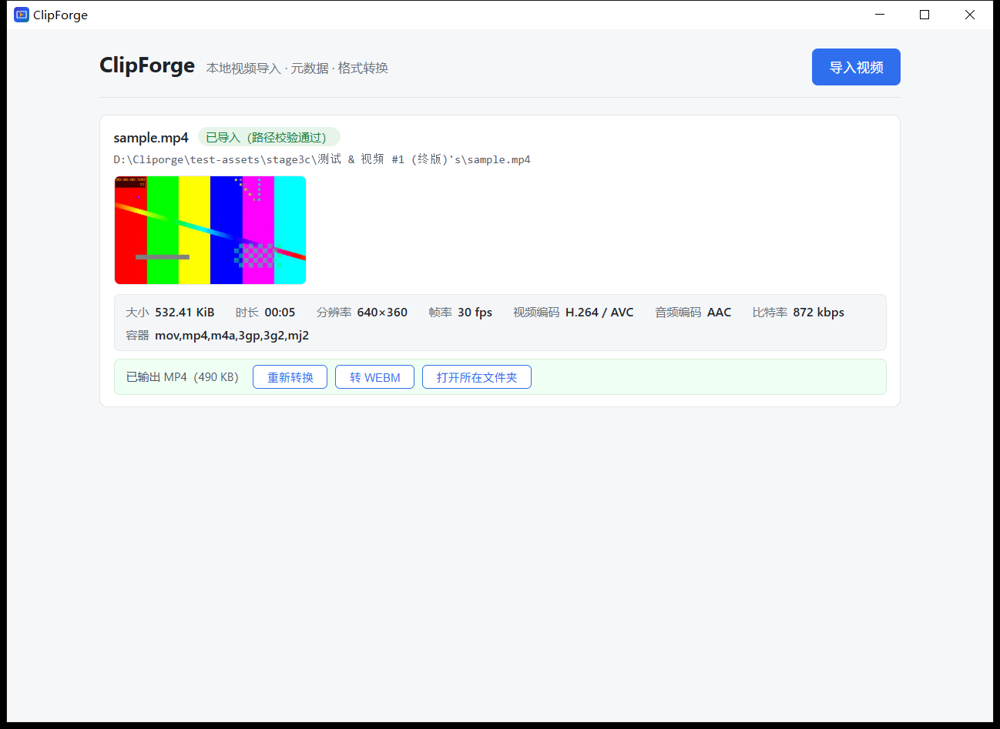
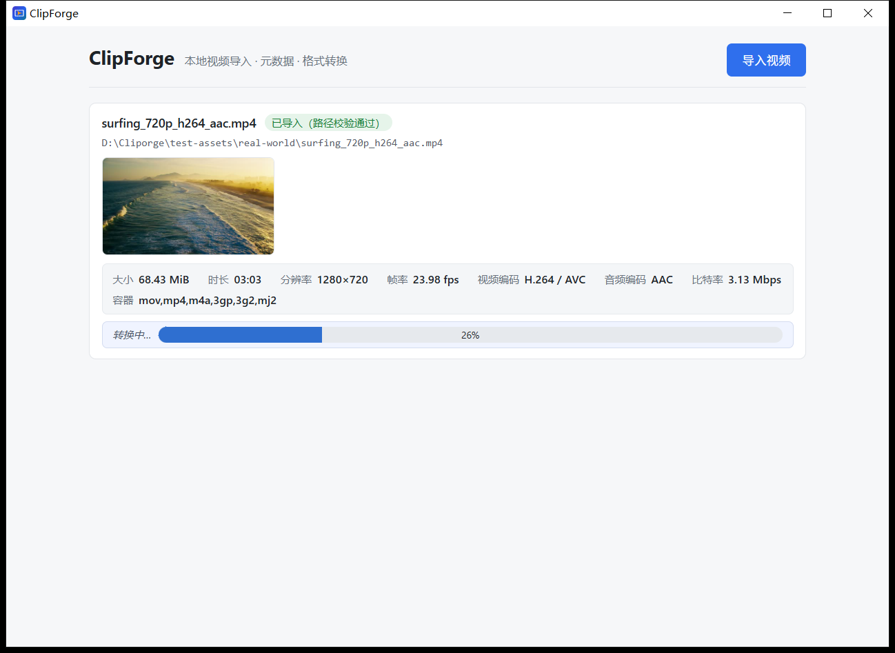
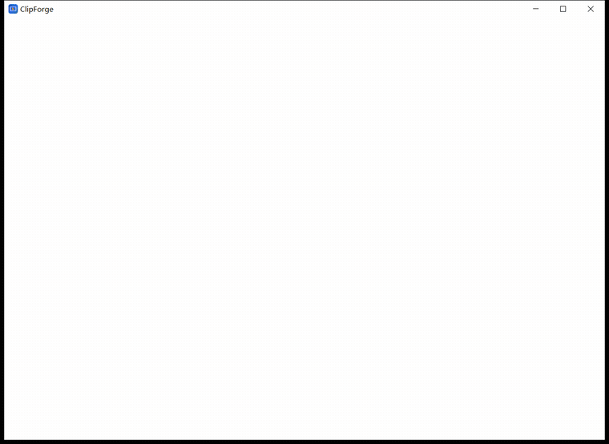

<div align="center">


# ClipForge

**本地视频导入 · 元数据 · 格式转换** —— Windows 桌面客户端

Tauri 2（Rust） + React 19 + TypeScript，调用本机 FFmpeg 命令行完成转码

</div>

---

## 快速开始（审核人请看这里）

1. 到本仓库 **Releases** 页下载最新版 `ClipForge_0.1.x_x64-setup.exe`
2. 双击安装。安装包未代码签名，若出现 SmartScreen"Windows 已保护你的电脑"提示：点 **更多信息 → 仍要运行**（属正常现象）
3. 前置依赖：本机需有 **FFmpeg / FFprobe**（应用调用系统 FFmpeg 转码）。未安装时一条命令装好：
   ```powershell
   winget install Gyan.FFmpeg
   ```
4. 打开 ClipForge → 点 **导入视频** → 选择视频 → 查看元数据与缩略图 → 点 **MP4** 或 **WebM**

> 提示：转 WebM 使用 VP8 编码，速度约为 MP4（H.264）的 5 倍耗时；长视频转 WebM 请耐心等待（默认超时 300 秒）。

## 界面

导入后立即显示真实元数据与真实缩略图（示例素材为中国路径 + 特殊字符路径，全链路实测通过）：





长视频转换显示**实时进度条**（183 秒素材，进度依赖元数据时长；时长缺失的容器不显示进度、不造假）：



**Demo 动图**（真实素材 Big Buck Bunny 720p，HEVC → H.264，release 版实机录制）：



## 功能

**导入**
- 系统文件对话框选文件；路径校验（文件不存在 / 不可读分别给出明确错误，不笼统提示"失败"）
- 同一路径重复导入自动判重提示
- 中文、空格、`&`、`#`、`'`、括号等特殊字符路径全链路实测通过

**元数据**（FFprobe）
- 大小、时长、分辨率、**帧率、比特率、容器格式**、视频编码、音频编码
- 无音轨如实显示"无音轨"；时长/比特率等缺失字段显示 `N/A` 而非编造数值；换算规则可与 FFprobe 原始值逐项核对
- 读取失败显示错误码 + 原始原因（如 `moov atom not found`），并可一键**重试**

**缩略图**
- 从视频真实首帧提取（不是占位图）；缓存命中不重复提取
- 损坏视频明确报告失败原因，**不冒充**真实缩略图

**转换**（FFmpeg 命令行）
- **MP4**：`libx264`（veryfast / CRF 23）+ `AAC 128k` + `faststart`
- **WebM**：`libvpx`（1 Mbps）+ `libvorbis`
- 输出到源文件旁 `{文件名}_converted.{扩展名}`；**同名自动递增序号（_2、_3…），绝不覆盖**源文件或既有输出
- 转换中显示**实时进度条**（长视频不再像卡死）；失败自动清理半成品，不留脏文件
- 完成后可 **[重新转换] / [转 WebM|转 MP4]（切换另一格式，无需重新导入）/ [打开所在文件夹]**；失败态可 **[重试] / [改用另一格式]**

**可靠性**（工程化细节，均有实测证据）
- 六类转换错误码：`CONV_NOT_FOUND / START_FAILED / NONZERO_EXIT / TIMEOUT / IO / CANCELLED`，均附原始工具输出片段
- 探测/转换超时（30s / 300s）与取消；**关闭应用会终止在途子进程并回收，不留孤儿进程**
- 日志轮转：5 MiB × 3 份，写入 `%LOCALAPPDATA%\com.clipforge.app\logs\`

## 从源码运行

前置：Windows 10/11、Node 18+、Rust（MSVC toolchain）、VS Build Tools、WebView2 Runtime、FFmpeg（在 PATH 中）

```bash
cd clipforge
npm install
npm run tauri dev      # 开发模式
npm run tauri build    # 打包（NSIS 安装包 → target/release/bundle/nsis/）
```

## 架构

| 层 | 技术 | 职责 |
|---|---|---|
| 前端 | React 19 + TypeScript + Vite | 界面、状态管理、交互 |
| 客户端壳 | Tauri 2（Rust） | 窗口、IPC、系统文件对话框、进程管理 |
| 后端模块（Rust） | `picker` / `import` / `probe` / `probe_lifecycle` / `thumbnail` / `converter` / `logging` | 文件选择与校验、FFprobe 元数据、任务生命周期（取消/超时/无孤儿进程）、缩略图与磁盘缓存、FFmpeg 转换、日志轮转 |

IPC 命令：`pick_video_file`、`create_import_entry`、`list_import_entries`、`probe_import_entry`、`request_thumbnail`、`convert_video`、`list_conversion_results`（定义见 `clipforge/src/importApi.ts` 与 `clipforge/src-tauri/src/lib.rs`）。

测试覆盖机制（Debug-only，release 不编译）：FFprobe 替身、受控超时、路径覆盖——用于稳定复现失败/超时路径，见 `clipforge/src-tauri/src/test_overrides.rs`。

## 测试与验证

- `cargo test`：**75 passed / 0 failed / 7 ignored**（EXIT=0；7 项为默认忽略的实机/受控环境测试）
- **真实 UI 驱动验收**（Windows UI Automation 驱动真实窗口与系统对话框，非 API 直调）：导入 / 元数据 / 缩略图 / MP4+WebM 转换 / 损坏视频错误态 / 特殊路径 / 退出清理 / 安装与卸载，逐项通过
- 完整过程证据（截图、日志、哈希基线）见 `docs/evidence/`

## 文档索引（工程过程，可逐项复核）

| 文档 | 内容 |
|---|---|
| [`docs/requirements-and-acceptance.md`](docs/requirements-and-acceptance.md) | 需求与验收规格（含各阶段 Gate 判据，v1.3） |
| [`docs/decision-log.md`](docs/decision-log.md) | **决策日志 D-0001 ~ D-0029**（含每条决策的开发者反馈与批准记录） |
| [`docs/ai-session-summary.md`](docs/ai-session-summary.md) | **人机协作会话总结**（含 AI 的失误与开发者纠正，如实记录、不事后美化） |
| [`docs/stage-0-audit.md`](docs/stage-0-audit.md) / [`docs/test-report.md`](docs/test-report.md) | 环境与方案审计 / 环境验收实测记录 |
| `docs/Stage-*.md` | 各阶段实施报告、基线检查与最终验收矩阵 |
| [`docs/Stage-4-Delivery-Report.md`](docs/Stage-4-Delivery-Report.md) | 交付包装报告（打包、安装验收、入库裁剪） |
| [`docs/evidence/`](docs/evidence/) | 全部原始证据（日志、截图、脚本、哈希） |

## 已知限制

- 需要本机安装 FFmpeg（见"快速开始"第 3 条）
- 进度条依赖容器提供总时长；时长缺失的素材不显示百分比（设计如此）
- 未实现（按题目范围主动裁剪）：批量转换、播放器、字幕、AI 功能
- 安装包未代码签名；转 WebM 较慢（VP8 约为 x264 的 5 倍）

## License

[MIT](LICENSE)
